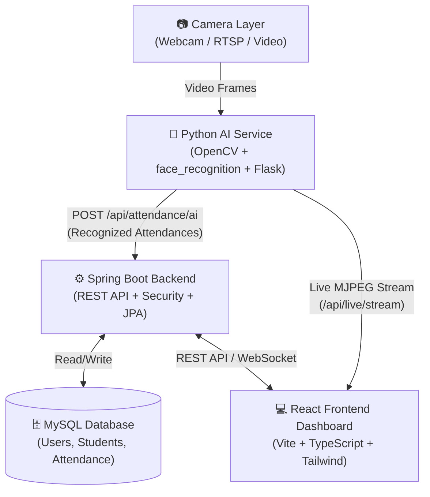

# System Architecture Diagram

### Component Details
1. **Camera Layer**: Ingests video from local webcam, IP camera (RTSP), or test video files.
2. **AI Service (Python 3.11)**: Detects human faces using HOG/Haar, extracts 128-d encodings, matches against enrolled student database, buffers offline events if disconnected.
3. **Backend API (Spring Boot 3.3.5)**: Handles authentication (JWT cookies), student enrollment photos, attendance persistence, rate limiting, and guardian notifications (Email & SMS).
4. **Database (MySQL 8)**: Persistent storage for users, roles, students, and timestamps.
5. **Frontend (React 18)**: Coordinator and Admin dashboard for real-time monitoring and reporting.
